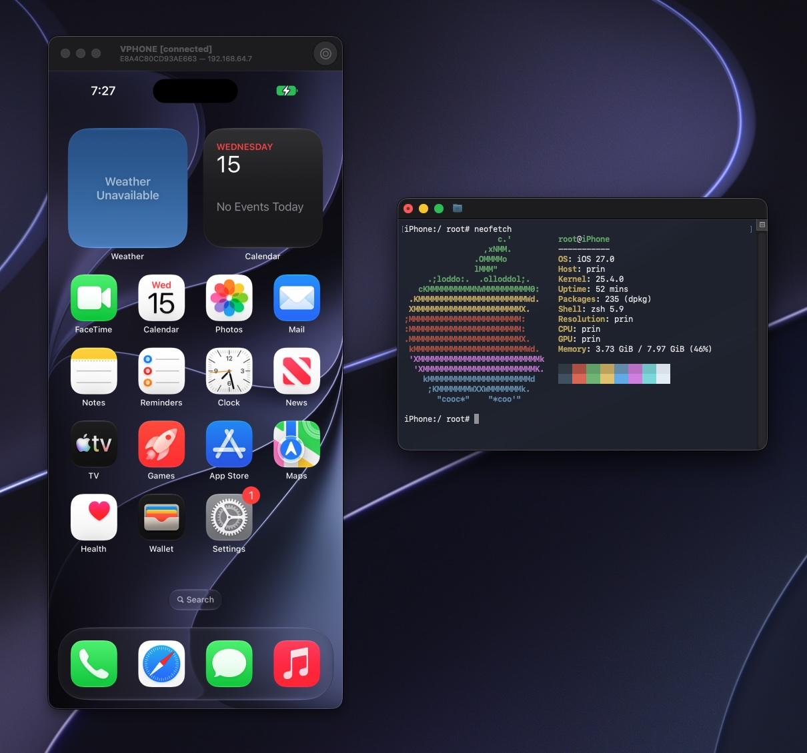

<div align="right"><a href="Documents/README.md">Docs</a> · <strong>English</strong> · <a href="Documents/README_zh.md">中文</a> · <a href="Documents/README_ja.md">日本語</a> · <a href="Documents/README_ko.md">한국어</a></div>

# vphone-cli

Run a virtual iPhone on an Apple Silicon Mac.

> [!WARNING]
> This project has never issued or authorized any cryptocurrency or token, and does not accept cryptocurrency payments or donations. Any cryptocurrency or token issued or promoted in this project's name, or claiming any affiliation with it, is a scam.



vphone-cli runs iOS with Apple's Virtualization.framework and PCC research virtual machines, for security research, reverse engineering, and debugging.

- **Graphical Window:** Use the virtual iPhone's screen on your Mac, browse apps and files, and take screenshots and screen recordings.
- **Custom Firmware:** The system comes pre-patched, and you can install a package environment.
- **Backup and Cloning:** You can export, import, and clone VMs.
- **Automation API:** An optional local HTTP and WebSocket interface.
- **No Extra Dependencies:** Needs no Xcode, Python, or Homebrew at runtime.

## Requirements

- A physical Apple Silicon Mac running macOS 15 or newer. It does not work in a macOS VM.
- Free disk space. Each VM has a 64 GB virtual disk by default, and firmware takes more.
- A network connection. Restoring the system fetches signing tickets online.
- Adjusted security settings. Boot into macOS Recovery, run these commands in Terminal, then restart:

  ```sh
  csrutil enable --without debug
  csrutil allow-research-guests enable
  ```

  SIP stays enabled, with only the debugging restrictions relaxed. For details, see [Host Setup](Documents/Guides/host-setup.md).

## Get Started

1. Download `vphone-launchpad-<version>-notarized.zip` from the [latest release](https://github.com/Lakr233/vphone-cli/releases/latest), unzip it, and open it. Not every release is notarized. If the latest one has no `-notarized` file, pick a notarized version from [Downloads](Documents/Downloads/README.md).
2. In **Host Setup**, grant Developer Tools access and install the helper.
3. In **Core Bundle**, click **Download and Install**.
4. In **Machines**, click **New Machine**, choose a firmware pairing, and click **Create**.

Launchpad downloads the firmware, patches it, restores the system, and boots the VM. To use your own iPhone and cloudOS IPSWs, see [Compatibility](Documents/Guides/compatibility.md).

To install a package manager in the VM, see [Package Environment](Documents/Guides/package-environment.md).

### Let an agent do it

If you use a coding agent (Claude Code, Codex, or similar) on this Mac, paste the prompt below instead of following the steps by hand. The agent reads the vphone skill, checks what is already set up, installs Launchpad and `VPhone.bundle`, and stops to ask when a step needs you, such as an administrator password or a change in macOS Recovery.

```text
Set up vphone on this Mac. Read the skill at
https://raw.githubusercontent.com/Lakr233/vphone-cli/main/Skills/vphone-guest-control/SKILL.md
and the files it links under references/ (same folder), then follow them:
install the newest notarized vphone-launchpad (not every release has a
-notarized zip), put vphone-launchpad-cli on PATH, install the VPhone.bundle
that matches Launchpad's series, and check `vphone-launchpad-cli status`.
Do not change SIP, boot-args or any other host security setting, and do not
create a machine until I confirm the firmware and the free disk space. When a
step needs me, tell me exactly what to do and wait.
```

## Command Line

Launchpad drives VMs through the `vphone-cli` inside `VPhone.bundle`. You can also run it in Terminal:

```sh
vphone-cli vm list
vphone-cli vm launch myphone
vphone-cli vm export myphone --out myphone.tzst
```

VMs are stored in `~/.vphone/`. Run `vphone-cli <group> --help` to see all commands. To create a VM without Launchpad, see [Create and Run](Documents/Guides/create-and-run.md).

To turn on the automation API, add `--api-listen 127.0.0.1:8765` at launch and use the token it prints. See the [API documentation](Research/vphoned_http_api.md).

## Boot ROMs

New VMs start from two open-source ROMs instead of the closed ones in Virtualization.framework:

- [OpenAVB](https://github.com/owngoal-dev/OpenAVB) replaces AVPBooter, the boot ROM. It needs no patch, so `fw patch` leaves it alone.
- [OpenSEP](https://github.com/owngoal-dev/OpenSEP) replaces AVPSEPBooter, the SEP boot ROM.

With both, nothing Apple wrote runs before iBoot and SEPOS. Both ship in `VPhone.bundle`, prebuilt from pinned upstream commits. Each one's README ([OpenAVB](VPhoneExecutable/VPhoneVirtualization/Resources/OpenAVB/README.md), [OpenSEP](VPhoneExecutable/VPhoneVirtualization/Resources/OpenSEP/README.md)) says how to rebuild it and check it byte for byte.

VMs created by earlier versions keep Apple's ROMs. A VM switches either way without a restore, from its next start:

```sh
vphone-cli vm config myphone --rom openavb --seprom opensep   # open-source ROMs
vphone-cli vm config myphone --rom apple --seprom apple       # Apple's ROMs
```

`vphone-cli vm info myphone` shows which ROMs a VM uses. Restoring a VM that boots OpenAVB needs `VPhone.bundle` 2.10.1 or newer. For the details, see [OpenAVB](Research/Firmware/openavb_boot_rom.md) and [OpenSEP](Research/Firmware/opensep_sep_rom.md) in the research notes.

## Documentation

| Document | Contents |
| --- | --- |
| [Downloads](Documents/Downloads/README.md) | Notarized Launchpad versions and matching `VPhone.bundle` versions |
| [Host Setup](Documents/Guides/host-setup.md) | SIP and AMFI settings, building from source, environment checks |
| [Create and Run](Documents/Guides/create-and-run.md) | The creation process, starting and stopping a VM |
| [Templates](Documents/Guides/templates.md) | Reusing one restore for many VMs, slimming the guest |
| [Library and Backups](Documents/Guides/library-and-backups.md) | Where VMs live, clones and exports |
| [Snapshots](Documents/Guides/snapshots.md) | Save a stopped VM's disk state and revert to it |
| [Compatibility](Documents/Guides/compatibility.md) | Verified firmware pairings |
| [iPadOS Guests](Documents/Guides/ipados.md) | Run iPadOS instead of iOS |
| [Other iPhone Models](Documents/Guides/iphone-models.md) | Run iOS from another iPhone model's IPSW |
| [Package Environment](Documents/Guides/package-environment.md) | Installing and removing a package manager in the VM |
| [Troubleshooting](Documents/Guides/troubleshooting.md) | Common errors and how to fix them |
| [Networking](Documents/Guides/networking.md) | Network modes, addresses, port forwarding, and `tunnel` for a Mac behind a VPN or proxy |
| [Launchpad Command Line](Documents/Guides/launchpad-cli.md) | Install and test a local build with `vphone-launchpad-cli` |
| [All Guides](Documents/README.md) | Every guide, grouped by subject |
| [Contributing](Documents/README.md#for-contributors) | Project structure, building from source, research notes |

If these do not solve your problem, [open an issue](https://github.com/Lakr233/vphone-cli/issues).

## Acknowledgements

- [wh1te4ever/super-tart-vphone-writeup](https://github.com/wh1te4ever/super-tart-vphone-writeup)
- [owngoal-dev/OpenAVB](https://github.com/owngoal-dev/OpenAVB) and [owngoal-dev/OpenSEP](https://github.com/owngoal-dev/OpenSEP), the boot ROMs new VMs start from
