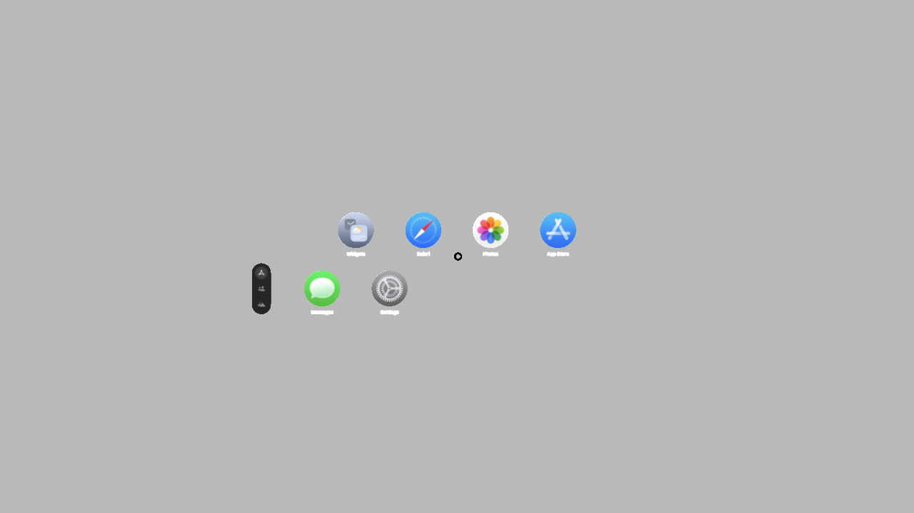
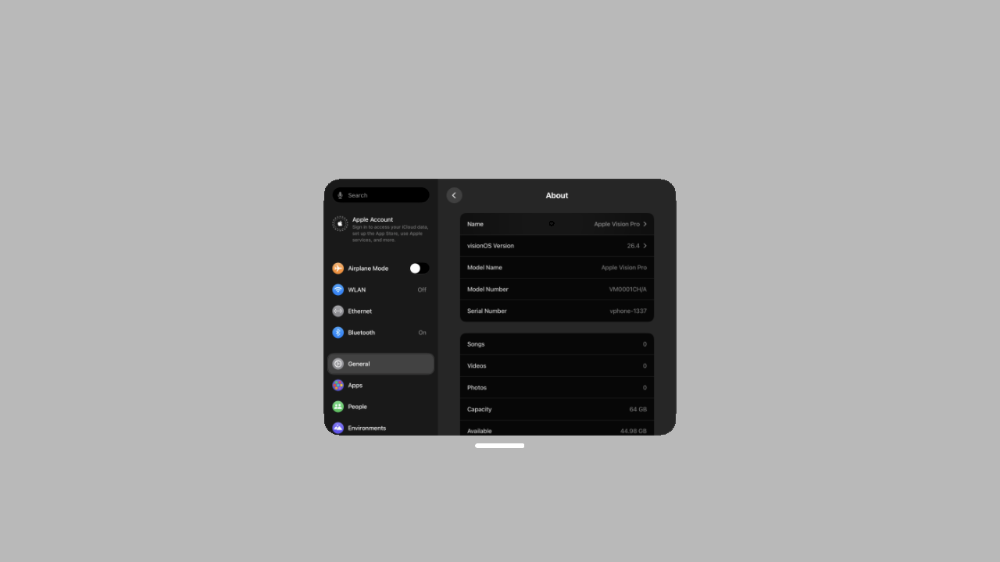
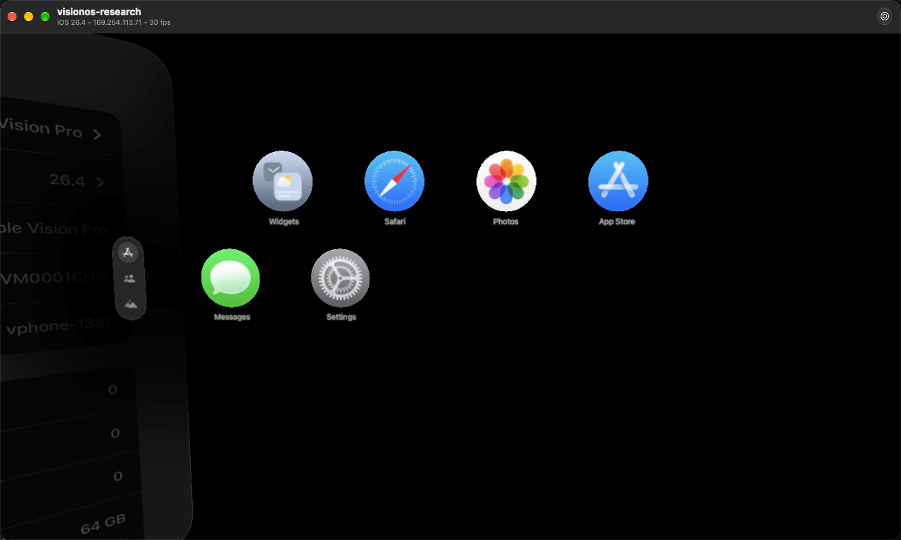

# visionOS 26.4 native UI bring-up

Experimental pairing: RealityDevice14,1 / N301AP, visionOS 26.4 (23O247),
with the cloudOS/PCC 26.4 research kernel and boot chain. The guest retains
Apple's visionOS userland, SurfBoard, backboardd, wakeboardd, UXM and Polaris.
The 1280 × 720 VM canvas is provisional; physical stereo output is unverified.

[Demonstration](https://x.com/onyxaxisowo/status/2118615639074263175)

## Verified checkpoint

The manually configured VM displayed native Home through the normal WBDisplayTap
composite path (intent 0). After a cold boot, mouse clicks opened Settings →
General → About, showing visionOS 26.4 and Apple Vision Pro. The final BGRA
surface contained 146,394 nonblack pixels, with all alpha values nonzero.
Independent inspection of the actual VM window matched the captured surface.
SurfBoard, backboardd and Preferences remained live; the final HMD Run sample
passed 2,638 frames. A preceding boot exceeded 11,101 frames.

Additional screenshot supplied by the author, showing native Home and the
Settings panel inside the actual VM window:

Physical tracking, stereo output, account sign-in and audio playback have not
been validated. This checkpoint establishes native rendering and mouse input
in this VM, rather than physical headset compatibility.

## Restore baseline

Use visionOS 26.4 restore userland and cloudOS 26.4 boot/kernel components.
Device detection recognizes RealityDevice14,1 and its xros erase identity.
The shared cache resides directly under `/System/Library/Caches/com.apple.dyld`.

The `visionos` preset supplies a headless baseline: donor board identity, PCC
boot/kernel patches, GPU bundle, launchd cache support and a Foundation-only
agent. It excludes the iPhone UI, camera, routing and shared-cache injections.
Every visionOS UI adapter remains an independent, off-by-default selection.

Both PCC Metal driver executables are re-signed after retargeting their
LC_BUILD_VERSION to platform 11 (VISIONOS). Only the exact 26.4 userland/26.4
kernel pair receives `ool_port_array_enforced=0`, matching the XR kernel's
native OOL-port-array default. Existing iOS 16–18 Skywalk arguments are retained.

## Independent UI selections

| Identifier | Change |
| --- | --- |
| `preboot-exp-visionos_virtual_product` | Replace only the known virtual iPhone token with native V201, selecting wakeboardd's IOMobileFramebuffer path. Retain RealityDevice14,1 board identity. |
| `system-launchdaemons-exp-visionos_nonfatal_services` | Journal and remove panic-on-crash fields from four headset jobs, retaining their native services. |
| `system-launchd-exp-visionos_uxm_ipc` | Install the scoped UXM/Polaris launchd adapter. |
| `system-launchd-exp-visionos_hmd_properties_ipc` | Permit only backboardd's lookup of `com.apple.wakeboard.hmdproperties`. |
| `system-launchd-exp-visionos_hmd_presentable_ipc` | Permit only backboardd's lookup of `com.apple.wakeboard.hmdpresentable.owner`. |
| `system-launchd-exp-visionos_hmd_system_setter_ipc` | Permit only backboardd's lookup of `com.apple.wakeboard.hmdsystemsetter`. |
| `system-launchd-exp-visionos_wakeboard_system_ipc` | Permit only backboardd's lookup of `com.apple.wakeboardd.system`. |
| `system-preferences-exp-visionos_skip_buddy` | Journal and apply mobile's native `com.apple.purplebuddy/ForceNoBuddy` Boolean on boot. |

UI adapters are gated to the reviewed 26.4/26.4 pair; the nonfatal job policy
is gated to the 26.4 userland. All are declared in the guest-system set.
`system-featureflags-exp-visionos_legacy_uxm` is a separate diagnostic trial:
it selects BoundaryManagerLegacy, but native ClientSession users abort in that
mode. Keep it off for native UI; the installer rejects combining it with IPC.

The IPC adapter runs only in PID 1. Its base rules permit UXM →
`com.apple.polaris.daemon_default` and Polaris → `com.apple.UXMSessionService`.
Each exception validates operation, name-filter type, audit token/current PID
version, executable path, signing identifier and trusted root-owned marker.
Other calls retain their original ABI, return value and errno. Native services
retain their command-level entitlement checks.

Each optional display rule requires the shared adapter and its own marker.
Opting out removes only that rule's marker. Removing the shared adapter restores
backed-up launchd before removing its library/alias; an absent backup fails
without deleting rollback data.

The onboarding helper is a one-shot mobile/mobile job (UID/GID 501), without
KeepAlive, private entitlements or a remote API. Its System policy lives at
`/usr/share/vphone/VisionOSSkipBuddy.plist`. Before changing ForceNoBuddy, it
durably publishes an inverse journal under mobile's Application Support/vphone
folder. It preserves original absence/false/true, rejects malformed values,
never overwrites an existing journal, and fsyncs newly created parent directories.
Opt-out retains the helper for the next boot to restore its own key while
preserving unrelated preferences. This early UI decision skips onboarding;
it does not record enrollment or modify activation/account records.

## Manual configuration in the verified VM

The checkpoint also includes the native UXM `PluginDenyList` entry
`RealityCameraUXMPlugin.plugin` in mobile's `com.apple.userexperiencemanagerd`
defaults. UXM otherwise blocks creating the absent IR-camera control expert.
Preserve the original preference and append only that entry through
CFPreferences as mobile. Rollback removes only that entry and restores original
absence where appropriate. **The current patch selections do not install this
additional preference.**

Keep stock UXMSharedMemoryBlackboard/UXMShim and SurfBoard feature fields enabled.
Keep `com.apple.RealitySimulation/DisabledHostOptions` absent (native default 4).
An earlier diagnostic mask of 5 disabled AudioSceneService and caused a nil-service
CoreRE crash after rendering progressed. Ordinary MuseBuddy SetupDone and
BuddyRunVersion trials did not remove onboarding and were restored to absence.

The checkpoint was assembled incrementally. Its original installer receipt was
retained instead of rewritten to certify manual deployment. These sources
package the adapters and reversals; a fresh end-to-end restore and boot with
the latest upstream-based bundle remains a separate validation step.

## Validation

Swift coverage checks device detection, platform retargeting, version gates,
product-token replacement, strict plist inverses, preset parity and independent
display dependencies. C tests cover IPC scope, ABI/errno forwarding, marker and
audit-token failures. Objective-C tests cover preference journal publication,
idempotence, malformed input, persistence failures and parent-directory durability.
Mock HID tests cover event allocation, timing, metadata and unavailable symbols.

The Foundation-only agent advertises HID only when visionOS APIs resolve.
`input.hid` validates numeric/Boolean types, serializes bounded submissions,
and reports submission rather than claiming a consumer handled the event.
The visible interaction checkpoint used the VM window's mouse path.

The upstream-based PR branch passed the complete VPhone bundle build and
admission check, 97 patch tests and 41 device/catalog tests, plus the native
IPC, preference and HID checks. The wider Core Kit suite is not green on this
host: 102 filesystem-fixture errors (ELOOP) also reproduce with unmodified
upstream sources, and a process-discovery timing assertion failed in one run.
