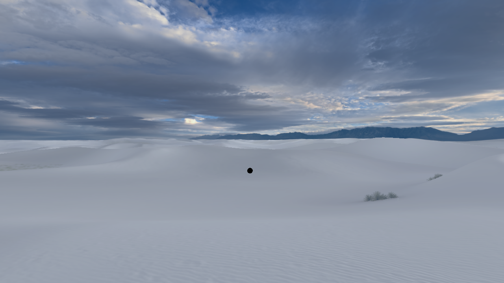

# visionOS 26.4 environment backgrounds

This change extends the native UI bring-up on `RealityDevice14,1`, userland
23O247 and the cloudOS/PCC 26.4 research kernel. The source baseline is upstream
main `8c5aa439`, whose marketing version remains 2.15.2.
The later [V201 pacing correction](visionos_frame_pacing.md) raises this existing
native environment path from the initial 30 fps checkpoint to about 60 fps.

## Three independent missing pieces

1. `RealityEnvironment` could not look up
   `com.apple.surfboard.environmentservice`. On 2026-11-08, both kernel and
   launchd logs recorded the exact lookup denial (159). The app then trapped
   in `+[BSServiceConnection(NSXPCConnection) NSXPCConnectionWithEndpoint:configurator:]`
   because the endpoint was nil. This is a current native crash, distinct from
   the earlier UIKit launch watchdog in the initial bring-up.
2. The native app's `SystemEnvironmentSceneAsset.state` getter checks
   `SFBSIsRunningOnPhysicalHardware`. On a virtual device, the native
   `RealityEnvironment/ShowEnvironmentsOnSimulator` feature flag must be on
   before ordinary environments can be selected. This gate is separate from
   asset availability; enabling it does not claim that a download has finished.
3. Selecting an environment presents Apple's “Adjust Immersion” instruction.
   A VM has no physical Digital Crown. Its native immersion level must be
   adjustable from the host for the environment to become visible.

## Installation and reversal

Both new patches are independently selectable and off in every shipped preset.
They are limited to the reviewed 26.4 userland/26.4 kernel pair.

- `system-launchd-exp-visionos_environment_ipc` requires the existing scoped
  UXM adapter. Its independent root-owned marker is
  `/usr/lib/vphone-visionos-environment-ipc`. It permits only the native app at
  `/Applications/RealityEnvironment.app/RealityEnvironment`, with signing
  identifier `com.apple.RealityEnvironment` and a kernel-validated audit token,
  to look up the single service above. Other operations, callers, services,
  return values and errno retain the original adapter behavior. Opt-out removes
  this marker alone; it does not modify the native server's authorization.
- `system-featureflags-exp-visionos_environments` changes only
  `ShowEnvironmentsOnSimulator/Enabled` in
  `/System/Library/FeatureFlags/Domain/RealityEnvironment.plist`. Before changing
  it, the installer stores its Boolean/absence and feature-entry presence in
  `/usr/share/vphone/VisionOSEnvironments.plist`. Rollback restores the owned
  field and retains unrelated metadata. Invalid values and conflicting
  `DevelopmentPhase` entries fail without changing the domain.

The existing native-UI selections and manual camera-plugin preference described
in [the bring-up recipe](visionos_bringup.md) remain prerequisites. This change
does not claim a fresh restore validates the whole recipe.

The existing lab's old `darwinos` preset name no longer resolves on current
main. Its desired selection was migrated to `visionos`, retaining the working
UI allowances and adding these two choices. The new preset's unrelated TXM
remap and kernel GLES choices were blocked for this existing VM, keeping its
installed boot chain. Its original receipt was preserved: the manually deployed
guest files and readbacks, rather than a rewritten receipt, certify this test.

## Native immersion control

`Device > Environment Immersion` offers Passthrough, Half Immersion (50%), and
Full Environment. It appears only when the connected agent advertises
`visionos_immersion`. Select an environment in native Home View first. A cloud
icon still means the asset must download normally.

The agent exposes `visionos.immersion.get` and `visionos.immersion.set` with a
finite numeric `level` in `[0, 1]`. Booleans and numeric strings are rejected.
Only the visionOS agent variant receives the native
`com.apple.surfboard.immersion-client` entitlement. Bundle admission checks that
it does not leak into the iOS, tvOS or watchOS variants or the host.

The bridge dynamically loads SurfBoardServices, checks the device identity and
method ABI, and calls the existing authenticated service:

| Selector | Verified 23O247 method encoding |
| --- | --- |
| `setImmersionLevel:immersionType:animationDuration:completion:` | `v40@0:8f16C20d24@?32` |
| `getImmersionLevelForType:completion:` | `v28@0:8C16@?20` |

The system-environment type is `uint8_t(0)`, also used by Apple's own app. The
setter takes `float`, type, `double(0.25)` animation duration and an NSError
completion. The getter independently returns `(float, NSError *)`.

A successful set response contains `requested_level`, the independently
observed `level`, `available` and `applied`. During the short native animation,
the observed level may still be between the old and requested values. The menu
does not claim that acknowledgement is an observation of a settled state.
Timeouts report uncertainty and preserve heap-owned state for late callbacks.
No compositor image, physical pose, projection or tracking state is injected.

The tempting `setAbsoluteImmersionLevel:` API follows the native dial curve:
in the observed VM, a request of 1 initially targeted about 0.3. The explicit
type-0 setter above was therefore used and independently read back as 1.0.

## Runtime evidence and validation

The existing VM displayed Apple's preinstalled White Sands environment at
about 30 fps in the actual host window. Its normal WBDisplayTap composite
(intent 0, no separate composite) contained 921,446 nonblack pixels out of
921,600 at 1280 × 720, with nonzero alpha throughout. The `Wolf` asset was
already present under `PreinstalledAssetsV2/RequiredByOs`; no replacement image
or host-rendered wallpaper was used.

Real agent requests for 0, 0.5 and 1 settled to matching independent readbacks.
Requests for -0.1, 1.1, Boolean true and string `"1"` were rejected while the
native level remained unchanged. A subsequent cold boot again displayed White
Sands after selecting it in native Home and adjusting immersion. The native OS
started that boot at level 0, so this is support for the selection and controls,
not a promise to restore immersion automatically at startup. After refreshing
AMFI admission, the rebuilt host's localized Device > Environment Immersion
menu was exercised directly: Passthrough, Half Immersion and Full Environment
settled to independent native readbacks of 0, 0.5 and 1 respectively. White Sands
rendered in that rebuilt host at about 30 fps. The final native composite had
921,440 nonblack pixels and 921,600 nonzero-alpha pixels at 1280 × 720.

Validation includes 73 patch-selection/catalogue/plist-inverse tests, IPC scope
and ABI forwarding tests, native immersion tests under AddressSanitizer
(including failure, malformed ABI, timeout and late completion), host menu
connection lifecycle tests, method catalogue/schema checks, and full bundle
build/admission. Physical passthrough cameras, tracking and stereo output remain
outside this test. Other environments still require their genuine assets.

All local source, build output, temporary data and evidence are on the external
volume. Investigation root:
`/Volumes/ZHITAI/Data/VPhone/Builds/visionos-background`.

Key records are `evidence/environment-denials.jsonl`,
`evidence/RealityEnvironment-current.ips`,
`evidence/native-service-crash-evidence.json`,
`native-investigation/findings.md`, `native-investigation/immersion-control.md`,
`evidence/white-sands-full.png`, `evidence/immersion-rpc-validation.json`,
`evidence/menu-{passthrough,half,full}-readback.json`,
`evidence/menu-final-frame.json` and `evidence/menu-final.png`.
The crash's retained REA Evidence ID is
`ev_6ca47d092453315a43913e526850396d5d05880b3524425581af25ed32739cd7`.
